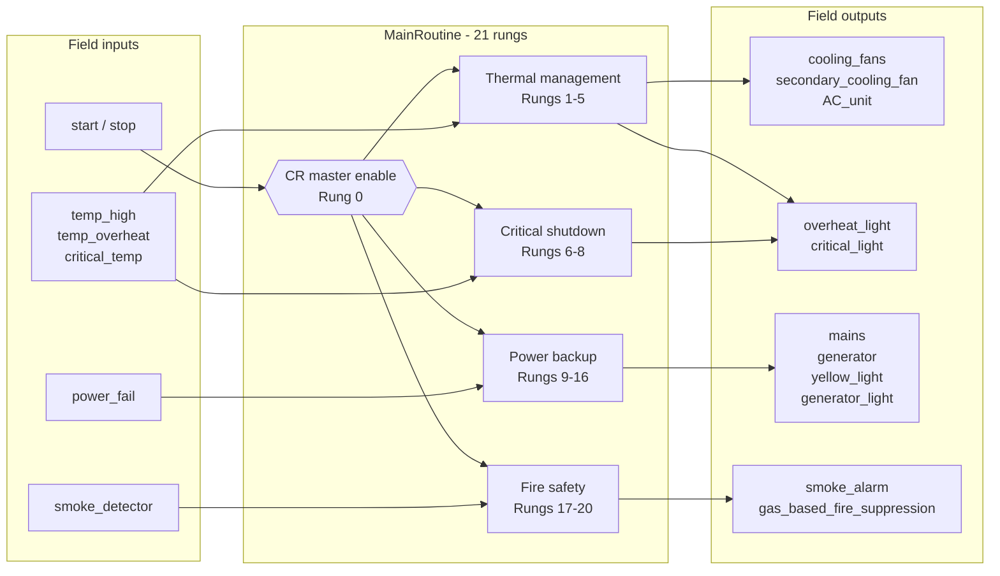
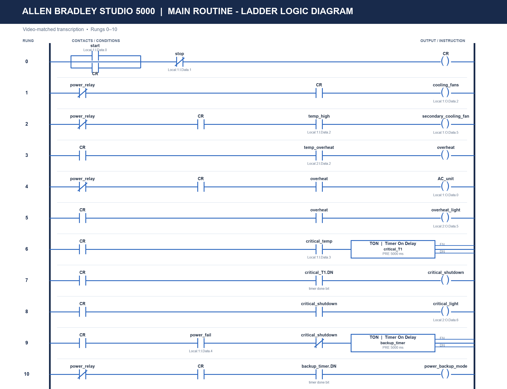
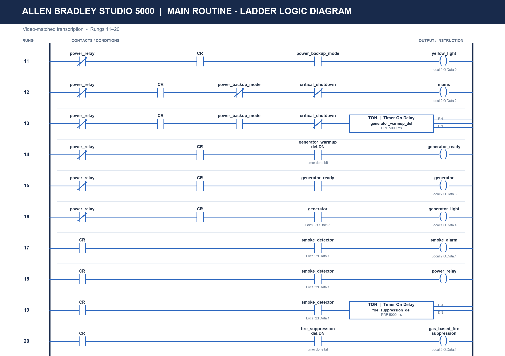
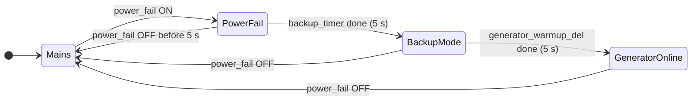
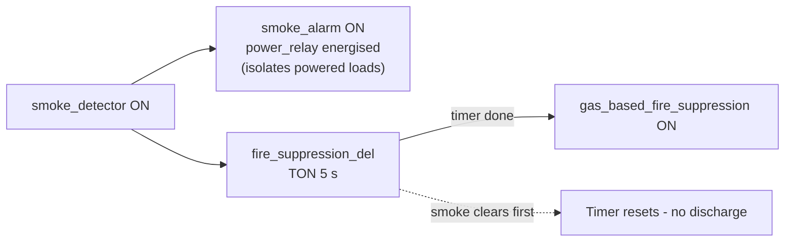

# Data Centre Cooling & Power Control System (PLC)


-green)


A PLC program that automates **thermal management, power continuity and fire protection** for a data-centre style facility. It is written as ladder logic in Rockwell Automation **Studio 5000 Logix Designer** and targets an Allen-Bradley ControlLogix / CompactLogix controller.

Built for the course **PLC and SCADA (23EI62)**, Department of Electronics and Instrumentation Engineering, Ramaiah Institute of Technology, Bengaluru.

**[Watch the demo video](https://drive.google.com/file/d/1kpZR0ttCyFPmK2jvLmLAvJLmI5sSEqdf/view?usp=sharing)** | **[Full project report (DOCX)](docs/PLC_SCADA_Project_Report.docx)**

---

## Contents

- [Problem statement](#problem-statement)
- [What the system does](#what-the-system-does)
- [Architecture](#architecture)
- [Ladder diagrams](#ladder-diagrams)
- [Sequences of operation](#sequences-of-operation)
- [Safety design principles](#safety-design-principles)
- [Skills demonstrated](#skills-demonstrated)
- [Repository structure](#repository-structure)
- [Reproducing the project](#reproducing-the-project)
- [Limitations and future work](#limitations-and-future-work)
- [Team](#team)

---

## Problem statement

A data centre must keep servers cool, stay powered through a mains failure, and respond safely to fire. These needs interact. For example, a backup generator must not start during an emergency shutdown, and gas suppression must not discharge into an occupied room without warning.

This project implements that behaviour as a single, interlocked PLC routine with **timer-confirmed safety actions** and a **master enable** that gates every output.

## What the system does

| Function | Behaviour |
|----------|-----------|
| **Start / stop** | Latching (seal-in) start/stop circuit drives a master Control Relay `CR`. No output is active unless `CR` is set. |
| **Staged cooling** | Primary fans run when started. A secondary fan joins on `temp_high`. The AC unit and overheat light come on at `temp_overheat`. |
| **Critical temperature shutdown** | `critical_temp` must persist for **5 s** (TON) before `critical_shutdown` asserts, which filters transient sensor spikes. The critical light turns on and mains and generator supply are inhibited. |
| **Automatic power failover** | `power_fail` must persist for **5 s** before backup mode starts. Mains drops, the yellow light turns on, and after a further **5 s** generator warm-up the generator contactor closes. |
| **Fire detection and suppression** | Smoke immediately raises an alarm and energises the isolation relay `power_relay`. After a **5 s** pre-discharge delay, gas suppression is released. |

## Architecture



The program is organised in five layers, from normal operation up to fire safety:

| Block | Rungs | Key inputs | Key outputs |
|-------|-------|------------|-------------|
| A. Start / Stop | 0 | `start`, `stop` | `CR` |
| B. Thermal management | 1-5 | `temp_high`, `temp_overheat` | `cooling_fans`, `secondary_cooling_fan`, `AC_unit`, `overheat_light` |
| C. Critical shutdown | 6-8 | `critical_temp`, `critical_T1.DN` | `critical_shutdown`, `critical_light` |
| D. Power backup | 9-16 | `power_fail`, `backup_timer.DN`, `generator_warmup_del.DN` | `power_backup_mode`, `yellow_light`, `mains`, `generator`, `generator_light` |
| E. Fire safety | 17-20 | `smoke_detector`, `fire_suppression_del.DN` | `smoke_alarm`, `power_relay`, `gas_based_fire_suppression` |

## Ladder diagrams

Studio 5000 main routine, captured from the running program.

**Rungs 0-10**



**Rungs 11-20**



## Sequences of operation

### Power failover

All steps are non-latching, so if `power_fail` clears the system returns to mains automatically.



| State | Active outputs |
|-------|----------------|
| Mains | `mains` |
| PowerFail (0-5 s) | `mains` (waiting to confirm the failure is not a flicker) |
| BackupMode (5-10 s) | `yellow_light` (`mains` dropped, generator warming up) |
| GeneratorOnline (10 s+) | `yellow_light`, `generator`, `generator_light` |

A `critical_shutdown` blocks the backup timer (rung 9) and the generator warm-up (rung 13), and drops `mains` (rung 12). The load is therefore isolated during a critical thermal event.

### Fire response



The 5 s pre-discharge delay gives personnel time to evacuate and filters out false triggers.

## Safety design principles

- **Master enable (`CR`)**: every rung is gated by one latched bit, giving a single point of control for the whole program.
- **Seal-in start/stop**: the system will not restart by itself after a stop.
- **Timer-confirmed events**: TON timers confirm critical temperature, power failure and fire before the system acts on them, which reduces nuisance trips.
- **Interlocks**: critical shutdown inhibits the backup sequence and generator.
- **Staged escalation**: warning, then overheat response, then critical shutdown.
- **Operator visibility**: dedicated lights and alarm for overheat, critical shutdown, backup mode, generator and smoke.

## Skills demonstrated

- Ladder logic design to **IEC 61131-3**: seal-in latches, interlocks, permissives and timer-based sequencing
- Rockwell **Studio 5000 Logix Designer**: tag-based programming, `TON` timer instructions, `Local:slot:I/O.Data.bit` I/O addressing
- Control philosophy design: layered safety, fail-safe thinking, and graceful degradation
- Industrial subsystems: HVAC/cooling control, generator transfer and warm-up sequencing, and fire detection and gas suppression
- Engineering documentation: I/O list, logic equations, verification scenarios and a critical design review

## Repository structure

```
.
├── README.md
├── LICENSE
├── .gitignore
└── docs/
    ├── PLC_SCADA_Project_Report.docx   Full academic report
    ├── io-list.md                      Inputs, outputs, internal tags, timers
    ├── logic-description.md            Rung-by-rung explanation and Boolean equations
    ├── verification-scenarios.md       Test scenarios with expected behaviour
    ├── design-review.md                Strengths, limitations, improvements
    └── images/
        ├── ladder-rungs-00-10.png
        └── ladder-rungs-11-20.png
```

## Reproducing the project

1. Open **Studio 5000 Logix Designer** and create a new project for a ControlLogix or CompactLogix controller.
2. Add digital input and output modules in slots 1 and 2, as listed in [`docs/io-list.md`](docs/io-list.md).
3. Create the tags and four `TIMER` tags (all `PRE = 5000` ms).
4. Enter the 21 rungs in `MainRoutine`, using the diagrams above and [`docs/logic-description.md`](docs/logic-description.md).
5. Download to a controller or run in **Logix Emulate**, then follow [`docs/verification-scenarios.md`](docs/verification-scenarios.md).

## Limitations and future work

This is an academic design, not a certified safety system. Key gaps and planned improvements are in [`docs/design-review.md`](docs/design-review.md). The main ones:

- Latch the critical shutdown and require an operator reset
- Add sensor-fault and watchdog handling
- Keep fire protection independent of the start/stop state
- Replace discrete temperature switches with analog inputs and hysteresis
- Connect an HMI/SCADA layer for monitoring and alarm management

## Team

| Name | Role |
|------|------|
| Shreyas R | Team member |
| M P Subbaiah | Team member |
| Yashas B R | Team member |

**Guide:** Dr. Nishi Shahnaj Haider, Professor, Department of Electronics and Instrumentation Engineering, Ramaiah Institute of Technology (Autonomous, affiliated to VTU), Bengaluru.

Report date: May 2026.

## License

Released under the [MIT License](LICENSE).
