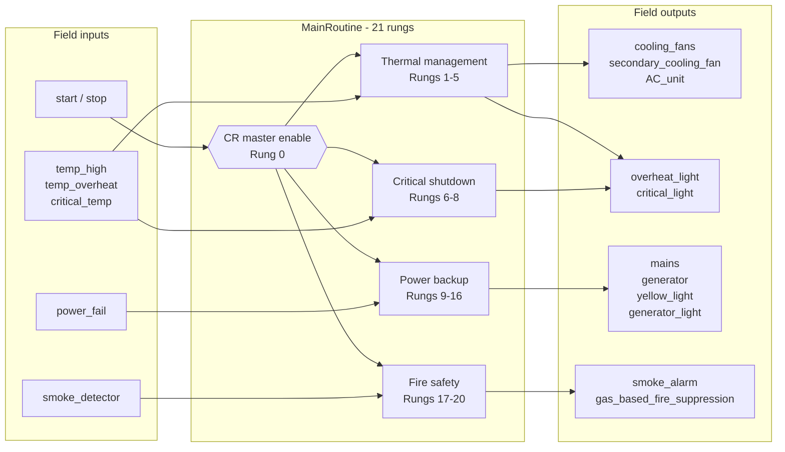
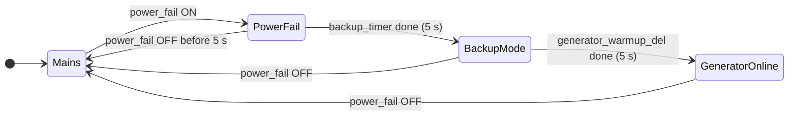
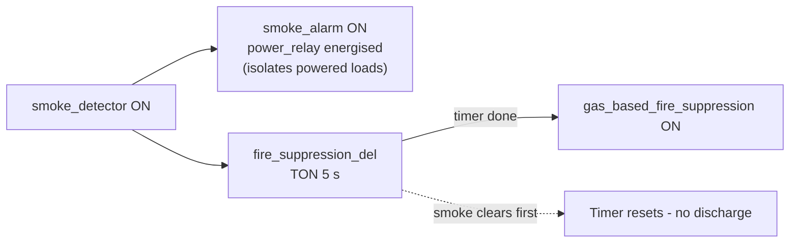

# Data Centre Cooling & Power Control System (PLC)


-green)


This is a PLC program we wrote for our PLC and SCADA course (23EI62) at Ramaiah Institute of Technology, Bengaluru. It looks after the three things a data centre can't go without: cooling, power and fire protection.

It's written in ladder logic using Rockwell Automation Studio 5000 Logix Designer, and it's meant for an Allen-Bradley ControlLogix or CompactLogix controller.

**[Watch the demo video](https://drive.google.com/file/d/1kpZR0ttCyFPmK2jvLmLAvJLmI5sSEqdf/view?usp=sharing)** | **[Read the full report (DOCX)](docs/PLC_SCADA_Project_Report.docx)**

---

## Contents

- [Why this project](#why-this-project)
- [What it does](#what-it-does)
- [How it's organised](#how-its-organised)
- [Ladder diagrams](#ladder-diagrams)
- [How the sequences work](#how-the-sequences-work)
- [Design choices for safety](#design-choices-for-safety)
- [What this project shows](#what-this-project-shows)
- [Repository layout](#repository-layout)
- [Rebuilding it yourself](#rebuilding-it-yourself)
- [Limitations and what we'd do next](#limitations-and-what-wed-do-next)
- [Team](#team)

---

## Why this project

A data centre has to stay cool, keep running when the mains fails, and react sensibly to a fire. These jobs get in each other's way. A backup generator shouldn't start in the middle of an emergency shutdown, and a gas suppression system shouldn't fire without giving anyone a warning.

We wanted to see how all of that fits into one PLC routine. The result is a single program where every output sits behind a master enable, and every serious event has to be confirmed by a timer before the system acts on it.

## What it does

| Function | What happens |
|----------|--------------|
| **Start / stop** | A seal-in start/stop circuit drives a master control relay, `CR`. If `CR` is off, nothing else runs. |
| **Cooling** | The primary fans run once the system is started. The secondary fan joins in on `temp_high`. At `temp_overheat` the AC unit and the overheat light come on. |
| **Critical temperature** | `critical_temp` has to stay on for **5 s** before `critical_shutdown` asserts, so a brief sensor spike doesn't trip it. The critical light comes on, and mains and generator supply are blocked. |
| **Power failover** | `power_fail` has to stay on for **5 s** before the system goes into backup mode. Mains drops and the yellow light comes on. After another **5 s** of generator warm-up, the generator contactor closes. |
| **Fire response** | Smoke triggers the alarm straight away and energises the isolation relay, `power_relay`. After a **5 s** pre-discharge delay, the gas suppression is released. |

## How it's organised



The program is split into five blocks, going from everyday operation up to fire safety:

| Block | Rungs | Main inputs | Main outputs |
|-------|-------|-------------|--------------|
| A. Start / stop | 0 | `start`, `stop` | `CR` |
| B. Thermal management | 1-5 | `temp_high`, `temp_overheat` | `cooling_fans`, `secondary_cooling_fan`, `AC_unit`, `overheat_light` |
| C. Critical shutdown | 6-8 | `critical_temp`, `critical_T1.DN` | `critical_shutdown`, `critical_light` |
| D. Power backup | 9-16 | `power_fail`, `backup_timer.DN`, `generator_warmup_del.DN` | `power_backup_mode`, `yellow_light`, `mains`, `generator`, `generator_light` |
| E. Fire safety | 17-20 | `smoke_detector`, `fire_suppression_del.DN` | `smoke_alarm`, `power_relay`, `gas_based_fire_suppression` |

## Ladder diagrams

These are from the Studio 5000 main routine, captured while the program was running.

**Rungs 0-10**


**Rungs 11-20**


## How the sequences work

### Power failover

None of the steps are latched. If `power_fail` clears at any point, the system drops back to mains on its own.



| State | Outputs that are on |
|-------|---------------------|
| Mains | `mains` |
| PowerFail (0-5 s) | `mains`, while the system waits to see whether it's just a flicker |
| BackupMode (5-10 s) | `yellow_light`. `mains` has dropped and the generator is warming up |
| GeneratorOnline (10 s onwards) | `yellow_light`, `generator`, `generator_light` |

If `critical_shutdown` is active, the backup timer (rung 9) and the generator warm-up (rung 13) are both blocked, and `mains` drops (rung 12). That isolates the load during a critical thermal event.

### Fire response



The 5 s delay gives people time to get out, and it also stops a false trigger from discharging the gas.

## Design choices for safety

- **One master enable.** Every rung is gated by `CR`, so there's a single point of control for the whole program.
- **Seal-in start/stop.** After a stop, the system stays stopped until someone presses start again.
- **Timers before action.** Critical temperature, power failure and fire all have to persist for 5 s, which cuts down on nuisance trips.
- **Interlocks.** A critical shutdown blocks the backup sequence and the generator.
- **Escalation in stages.** The response goes from warning, to overheat, to critical shutdown.
- **Clear feedback for operators.** There are separate lights and an alarm for overheat, critical shutdown, backup mode, generator running and smoke.

## What this project shows

- Ladder logic design to IEC 61131-3, including seal-in latches, interlocks, permissives and timer-based sequencing
- Working in Studio 5000 Logix Designer, with tag-based programming, `TON` timers and `Local:slot:I/O.Data.bit` addressing
- Thinking through a control philosophy in layers, and what should happen when things go wrong
- Three industrial subsystems in one program: cooling control, generator transfer with warm-up, and fire detection with gas suppression
- Documenting the work properly with an I/O list, logic equations, test scenarios and an honest design review

## Repository layout

```
.
├── README.md
├── LICENSE
├── .gitignore
└── docs/
    ├── PLC_SCADA_Project_Report.docx   Full academic report
    ├── io-list.md                      Inputs, outputs, internal tags and timers
    ├── logic-description.md            Rung-by-rung explanation with Boolean equations
    ├── verification-scenarios.md       Test scenarios and expected behaviour
    ├── design-review.md                What works, what doesn't, what to improve
    └── images/
        ├── ladder-rungs-00-10.png
        └── ladder-rungs-11-20.png
```

## Rebuilding it yourself

1. Open Studio 5000 Logix Designer and create a new project for a ControlLogix or CompactLogix controller.
2. Add digital input and output modules in slots 1 and 2, as listed in [`docs/io-list.md`](docs/io-list.md).
3. Create the tags, including four `TIMER` tags with `PRE = 5000` ms.
4. Enter the 21 rungs in `MainRoutine`, using the diagrams above and [`docs/logic-description.md`](docs/logic-description.md).
5. Download to a controller or run it in Logix Emulate, then work through [`docs/verification-scenarios.md`](docs/verification-scenarios.md).

## Limitations and what we'd do next

This is a student project, not a certified safety system. We've written down the gaps we know about in [`docs/design-review.md`](docs/design-review.md). The main ones:

- Latch the critical shutdown so an operator has to reset it
- Handle sensor faults and add a watchdog
- Keep fire protection working even when the system is stopped
- Use analog temperature inputs with hysteresis instead of simple switches
- Add an HMI/SCADA layer for monitoring and alarm management


## License

Released under the [MIT License](LICENSE).
